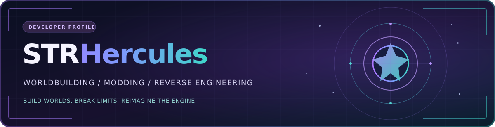
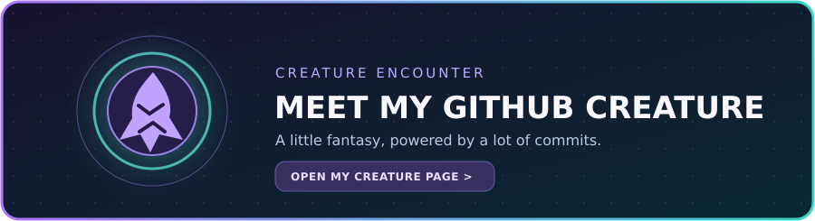

<!--
  STRHercules / STRHercules — GitHub profile README
  All featured repositories and descriptions were checked against their public READMEs.
  The GitHub Creature panel links to the real creature page. To show the original artwork
  instead, download the card image from GitHub Creature and add it as assets/my-creature.png.
-->

  

  
<strong>Game systems developer · World builder · Mod author · Reverse-engineering enthusiast</strong>

  
From rebuilding a Wrath-era client to giving Minecraft companions lives of their own. I like ambitious projects, deep systems, and turning <em>"what if?"</em> into working code.

  

    
    
    
  

---

## The projects at the center of my work

<table>
  <tr>
    <td width="50%" valign="top">
      <h3><a href="https://github.com/STRHercules/EsteriaWoW">Esteria</a></h3>
      
<strong>A different kind of Azeroth.</strong> An expanded <em>World of Warcraft 3.3.5a</em> experience, built on AzerothCore, Eluna and PlayerBots, with a matching custom client.

      
Expanded playable races, a persistent third faction, redesigned character creation, deeper progression systems and a growing library of custom gameplay modules.

      
      
    </td>
    <td width="50%" valign="top">
      <h3><a href="https://github.com/STRHercules/wowdecomp">wowdecomp · Esteria fork</a></h3>
      
<strong>Reconstructing the client, expanding the possibilities.</strong> My fork of <a href="https://github.com/SatyPardus/wowdecomp">SatyPardus/wowdecomp</a> works with the WotLK 3.3.5a (12340) client in C++.

      
Experimental Vulkan rendering, retail model support, expanded character customization, native UI extensions and the foundation for client features that need more than an addon.

      
      
    </td>
  </tr>
  <tr>
    <td width="50%" valign="top">
      <h3><a href="https://github.com/STRHercules/ModernCompanions">Modern Companions</a></h3>
      
<strong>Minecraft followers with more to do than follow.</strong> A NeoForge 1.21.1 port and expansion of Human Companions that leans into party-based RPG gameplay.

      
Distinct roles and progression, equipment and inventory, personalities, bond and morale, Soul Gems, voice callouts, magic integrations and experimental living professions.

      
      
    </td>
    <td width="50%" valign="top">
      <h3><a href="https://github.com/STRHercules/ModernChickens">Modern Chickens</a></h3>
      
<strong>Breeding, automation and an unreasonable number of chickens.</strong> A modern NeoForge take on the classic Chickens/Roost gameplay loop.

      
Data-driven breeding trees, resource and fluid/chemical chickens, roosts and collectors, specialized converters and cross-mod integrations including Mekanism.

      
      
    </td>
  </tr>
</table>

### <a href="https://github.com/STRHercules/LivingBalancer">LivingBalancer</a> · Developer tooling with a pulse

A **local-first development dashboard** that builds on CodexLB and TokDash. LivingBalancer turns project and session metadata into **Living Codex**: an explorable universe of project star systems, activity, integrations and automations. It also brings local token, usage and model reporting into one interface.

- **Explore the work:** project systems, sessions and activity visualized without storing prompt or response contents.
- **Understand the tools:** usage breakdowns and integrations for supported local coding assistants.
- **Keep it local:** Docker-powered services and a localhost observer, designed for local operation rather than public exposure.

> **A note on the workshop:** Some Esteria and wowdecomp features are experimental, opt-in or still being validated. The individual repositories distinguish implemented systems from staged designs and works in progress.

---

## My GitHub Creature

  
  
<em>Every repository has a story. Apparently mine has a creature, too.</em>

  <a href="https://www.githubcreature.com/strhercules"><strong>Meet my creature on GitHub Creature</strong></a>

<!-- To replace the gateway card with your original creature art:
     1. On https://www.githubcreature.com/strhercules choose Download > Card with effects.
     2. Save the image in this repository as assets/my-creature.png.
     3. Change ./assets/creature-gateway.svg to ./assets/my-creature.png above.
     The external card page remains linked either way. -->

---

## Toolbox

  

**What I spend my time on:**

| Game engineering | Modding and systems | Developer tooling |
|:---|:---|:---|
| C++ client work and reverse engineering | NeoForge, Minecraft systems and game AI | Local dashboards and telemetry |
| AzerothCore, Eluna and WotLK extensions | RPG progression, content pipelines and custom assets | Automation, integrations and Docker |
| Rendering, UI and client/server protocols | Data-driven content and cross-mod compatibility | TypeScript, Python and practical utilities |

## More things I've built and explored

Beyond the five projects above, I enjoy experimenting with **Stardew Valley modding**, **WoW addons**, **community tools** and game-related utilities. The full collection is over on [my repositories page](https://github.com/STRHercules?tab=repositories).

---

## GitHub activity

  
  

  

Stats are provided by third-party generators and may occasionally be rate-limited. Language cards reflect public repository analysis rather than a complete accounting of all coding time.

---

  <strong>Build worlds. Break limits. Reimagine what old engines can do.</strong>
  

    <a href="https://github.com/STRHercules/EsteriaWoW">Esteria</a> ·
    <a href="https://github.com/STRHercules/wowdecomp">wowdecomp</a> ·
    <a href="https://github.com/STRHercules/ModernCompanions">Modern Companions</a> ·
    <a href="https://github.com/STRHercules/ModernChickens">Modern Chickens</a> ·
    <a href="https://github.com/STRHercules/LivingBalancer">LivingBalancer</a>
  

  Independent fan projects and experiments. World of Warcraft and Minecraft are trademarks of their respective owners.

